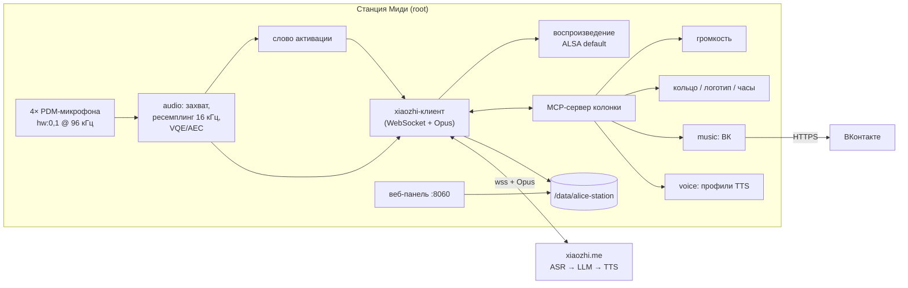

# Архитектура

## Идея в одном абзаце

На колонке работает один демон — **`alice-station-agent`**. Он сам слушает микрофоны,
ловит слово активации, стримит голос в облако **XiaoZhi** по его WebSocket-протоколу и
проигрывает ответ. Всё, что колонка умеет «руками» (громкость, свет, музыка, таймеры),
отдаётся модели как **MCP-инструменты** — ровно так, как это делает прошивка
xiaozhi-esp32. Штатная Алиса на первых этапах остаётся рядом как запасной вариант и
источник облачного TTS, а на финальном этапе отключается.

## Компоненты

### 1. `xiaozhi/` — клиент протокола XiaoZhi

Прошивку xiaozhi-esp32 нельзя запустить на Миди напрямую: она написана под ESP-IDF
(FreeRTOS, NVS, esp_http). Поэтому «вытягиваем библиотеку» как **переписанный клиент
протокола**, сверяясь с исходниками `main/ota.cc`, `main/protocols/websocket_protocol.cc`,
`main/mcp_server.cc` и `docs/websocket.md`, `docs/mcp-protocol.md`.

Поток:

1. **Проверка версии / активация.** `POST https://api.tenclass.net/xiaozhi/ota/`
   (значение `CONFIG_OTA_URL` по умолчанию) с заголовками `Device-Id` (MAC), `Client-Id`
   (UUID), `Activation-Version`, `User-Agent`, `Accept-Language`, в теле — JSON
   с описанием «платы». Ответ:
    - `activation.code` — 6-значный код: колонка произносит его / показывает на часах,
      пользователь добавляет устройство в консоли xiaozhi.me;
    - `websocket.url` и `websocket.token` — куда подключаться;
    - `server_time` — синхронизация часов. Раздел `firmware` игнорируем.
2. **WebSocket.** Заголовки `Authorization: Bearer <token>`, `Protocol-Version`,
   `Device-Id`, `Client-Id`. Сразу шлём `hello` (`audio_params`: opus, 16 кГц, моно,
   60 мс; `features.mcp: true`), ждём серверный `hello` (до 10 с) с `session_id`
   и параметрами выходного аудио (обычно 24 кГц).
3. **Сессия.** `listen start/stop/detect` + бинарные Opus-кадры вверх; вниз — `stt`,
   `llm` (эмоция → анимация кольца), `tts start/sentence_start/stop` и Opus-кадры.
   `abort` — перебивание голосом или кнопкой.
4. **MCP.** Сообщения `type: "mcp"` с JSON-RPC 2.0: сервер вызывает `initialize`,
   `tools/list`, `tools/call`; колонка отвечает. Имена инструментов — в стиле
   xiaozhi (`self.audio_speaker.set_volume`, `self.light.set_rgb`, …), чтобы облако
   понимало их «из коробки».

Отдельный модуль без привязки к колонке: его же запускаем на ПК как эмулятор
(`tools/`) — микрофон и динамик ноутбука вместо Станции. Это главный способ отлаживать
без SSH.

### 2. `audio/` — звук

- **Захват.** `arecord -D hw:0,1 -f S16_LE -c 4 -r 96000` — по вики это единственная
  частота, на которой можно писать **параллельно с Алисой**, не ломая её поток. Дальше
  берём 1–2 канала (или бимформинг по 4), ресемплируем в 16 кГц моно.
- **Эхо.** Пока звучит ответ/музыка, микрофон слышит колонку. Варианты по возрастанию
  сложности: (а) half-duplex — не слушать во время воспроизведения, кроме слова
  активации с приглушением громкости; (б) `LOOPBACK-A` как опорный сигнал + WebRTC AEC;
  (в) достать обработанный VQE-поток из `maind`, как сделано для Лайт 2.
- **Слово активации.** Этап 1 — триггер через штатную Алису («Алиса, включи нейросеть» /
  кнопка), как в MidiPult. Этап 2 — своё слово на устройстве (openWakeWord или
  sherpa-onnx KWS; Cortex-A55 @ 2 ГГц должен справиться).
- **Воспроизведение.** В ALSA `default` (тот же `softvol Master`, что у Алисы), через
  GStreamer `maind --gst-launch` или собственный декодер Opus. Громкость — общая.

### 3. `voice/` — настраиваемый голос

Два уровня:

1. **Голос облака.** В консоли xiaozhi.me у агента выбирается голос TTS. Это основной
   и самый простой способ.
2. **Локальная подмена.** Профиль голоса в `config.toml`: если выбран локальный
   движок, колонка игнорирует облачный Opus и озвучивает текст из `tts sentence_start`
   сама. Кандидаты: Piper (офлайн, русские голоса), облачный TTS Яндекса через
   колонку (`START_VOCALIZE`/glagol, голос Алисы), любой OpenAI-совместимый TTS по URL.
   Переключение — MCP-инструментом («смени голос на …») и в веб-панели.

### 4. `music/` — ВКонтакте

MCP-инструменты `music.search`, `music.play`, `music.wave` («моя волна»),
`music.pause/next/like`. Провайдер работает **от имени аккаунта пользователя**
(токен хранится только на колонке, `600`). «Моя волна» — это термин Яндекс Музыки;
у ВК аналог — рекомендательный поток / «VK Микс», его и берём за основу.

Открытые вопросы — см. [роадмап, этап 4](roadmap.md#stage-4). Важно: ограничения
бесплатного режима ВК (реклама, фоновое прослушивание) задаёт сам сервис. Обход
платного доступа и вырезание рекламы из чужого сервиса в проект не входят: целимся
в работу через аккаунт пользователя, при необходимости — с подпиской VK Музыки / VK Combo.

### 5. `tools/` — MCP-инструменты колонки

| Инструмент | Что делает | Как на Миди |
|---|---|---|
| `self.get_device_status` | громкость, сеть, что играет | `amixer`, состояние агента |
| `self.audio_speaker.set_volume` | громкость 0–100 | `amixer set Master N%` |
| `self.light.set_rgb` / эффекты | кольцо и логотип | `/dev/fb0` (24×1), `/dev/fb1` (6×1), `/sys/class/leds/cucumber:*` |
| `self.clock.show_text` | часы/цифры на циферблате | `cucumber:white:clock-*` |
| `self.timer.*` | таймеры и будильники | свой планировщик в агенте |
| `music.*` | музыка ВК | см. выше |
| `self.voice.set_profile` | смена голоса | см. выше |

### 6. `panel/` — веб-панель

Локальная страница (по умолчанию порт `8060`, только LAN, PIN): код активации
xiaozhi.me, кнопка диалога, громкость, выбор голоса, радио, повторная активация.
Можно встроиться в существующий [MidiPult](https://github.com/RoBiN19666/midipult)
вместо своей панели — решим на этапе 5.

## Язык и сборка

- **Сейчас — Python 3.11+** (есть в Entware, на нём же MidiPult). Зависимости: `websockets`
  и `libopus` из `opkg` (обёртка через ctypes, без `opuslib`). Захват идёт через PCM
  `alice_mic` из `deploy/asoundrc`: ресемплинг 96 → 16 кГц делает ALSA, а не Python.
- **Финальный агент — Go**, статический бинарник `linux/arm64` (userspace Миди
  64-битный): одна копия, без зависимостей Entware, мало памяти. Opus — через cgo
  с `libopus` в статике.

## Хранение и откат

- Всё своё — в `/data/alice-station/` (конфиг, токены `600`, логи) и
  `/data/opt/alice-station/` (бинарники). Системный раздел не трогаем, пока это возможно.
- Автозапуск — init-скрипт, ставится и снимается `deploy/install.sh` / `uninstall.sh`.
- Перед любым изменением `quasar.cfg` или `launch.json` — копия оригинала, проверка
  JSON на ПК, документированный откат (по правилам вики).
